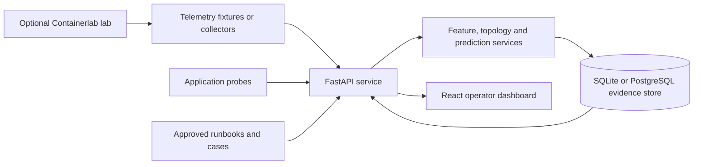

# PRAHARI

PRAHARI is a local, human-controlled network observability platform for investigating degradation in a controlled SD-WAN/MPLS-style lab.

It collects and validates network and application telemetry, records evidence in SQL, produces explainable incident assessments, and presents approved runbook context to an operator. The project is designed as a research and demonstration platform: it does not autonomously change network devices.

## Overview

The project demonstrates a safe workflow for a gradual network degradation scenario. A FastAPI service normalizes measurements, derives features, ranks the affected path or site, and stores evidence and review history. A React dashboard shows the assessment, incident workflow, closure cases, and audit trail. A Containerlab/FRRouting topology supplies an optional isolated Linux lab for measured traffic and guarded `tc netem` fault injection.

The default local API runs in replay mode with checked-in fixtures. Production-oriented deployment files are included, but deployment remains gated on approved models, protected identities, HTTPS, and recorded acceptance evidence.

## Features

- Validated API for telemetry, topology, incidents, closure cases, audit records, and action operations.
- SQLite replay workflow for local development and PostgreSQL support with Alembic migrations.
- Explainable baseline and predictive-model paths with approval checks and network-profile validation.
- Local, evidence-bound runbook retrieval and a schema-constrained copilot integration.
- Role-aware browser sessions, API-key authentication, audit records, and guarded action workflows.
- React operator dashboard with runtime response validation and fixture-mode indicators.
- Optional bounded chat/file traffic demonstration with latency, throughput, and checksum evidence.
- Containerlab/FRRouting lab configuration and allow-listed fault scripts for Linux hosts.

## Tech stack

| Area | Technology |
| --- | --- |
| API | Python 3.11–3.14, FastAPI, Uvicorn, Pydantic |
| Data | SQLAlchemy, Alembic, SQLite, PostgreSQL with psycopg |
| Analytics | NumPy, LightGBM |
| Dashboard | React, TypeScript, Vite, Zod, Vitest |
| Observability | Prometheus client and alert-rule tests |
| Deployment | Docker Compose, Nginx, Linux systemd templates |
| Lab | Containerlab, FRRouting/OSPF, `tc netem` |

## Architecture



The API is the trust boundary: it validates input, persists evidence, enforces review and approval states, and renders only supported copilot statements. The dashboard does not contain network credentials or execute router commands.

## Project structure

```text
apps/
  dashboard/          React operator dashboard
  user-demo/          Static bounded traffic-demo client
src/prahari/          FastAPI service and domain modules
tests/                Backend, deployment, and workflow tests
alembic/              Database migrations
config/               Network profiles, inventory, and playbooks
fixtures/             Checked-in replay inputs
scripts/              Development, collection, training, and validation tools
network-lab/          Containerlab topology, FRR configuration, and lab scripts
deploy/                Docker, Compose, Nginx, monitoring, and secret templates
docs/                 Canonical architecture, operations, and development guides
```

Generated databases, model outputs, recordings, lab state, build output, and local credentials are intentionally excluded from version control.

## Prerequisites

- [uv](https://docs.astral.sh/uv/) and Python 3.11–3.14 for the API.
- Node.js 22+ and npm for the dashboard.
- Docker, Docker Compose, Containerlab, and a Linux-capable host only for the optional network lab and Compose deployment.

## Installation

```powershell
uv sync --all-groups
Set-Location apps/dashboard
npm ci
Set-Location ../..
```

## Running locally

Start the replay-backed API from the repository root:

```powershell
uv run python scripts/replay_demo.py
uv run uvicorn prahari.main:app --app-dir src --reload
```

Open the API documentation at `http://127.0.0.1:8000/docs`.

In another terminal, start the dashboard:

```powershell
Set-Location apps/dashboard
npm run dev
```

Open `http://127.0.0.1:5173`. The Vite development server proxies API requests to the local service by default.

## Environment variables

The local replay workflow needs no environment file. Runtime settings use the `PRAHARI_` prefix and have safe development defaults.

- Use [apps/dashboard/.env.example](apps/dashboard/.env.example) only to configure the dashboard's development proxy or a separately hosted API.
- Use [deploy/.env.example](deploy/.env.example) for the Linux Compose scaffold. It contains placeholders and references secret files only.
- Use [deploy/.env.production.example](deploy/.env.production.example) as a validation-only production template. It is deliberately not deployable.

Never commit `.env` files, API keys, database URLs with credentials, browser account files, generated TLS keys, or lab tokens.

## API documentation

FastAPI serves the complete interactive API specification at `/docs` while running. Common endpoints include:

| Method | Endpoint | Description |
| --- | --- | --- |
| `GET` | `/health` | Service mode and health status. |
| `GET` | `/readyz` | Readiness probe. |
| `GET` | `/api/topology` | Validated topology view. |
| `GET` | `/api/metrics` | Normalized metric records. |
| `GET` | `/api/incidents` | Incident assessments. |
| `POST` | `/api/incidents/{incident_id}/review` | Record an operator review. |
| `GET` | `/api/cases` | Reviewed closure cases. |
| `GET` | `/api/models` | Model status and metadata. |
| `GET` | `/api/action-operations` | Auditable action-operation records. |

## Verification

Run the backend checks from the repository root:

```powershell
uv run ruff check .
uv run pytest
```

Run the dashboard checks from `apps/dashboard`:

```powershell
npm test
npm run build
```

The optional PostgreSQL integration tests use `PRAHARI_TEST_POSTGRES_URL`. The GitHub Actions workflow provisions an ephemeral PostgreSQL service for them.

## Deployment and network lab

The Compose files under [deploy](deploy/README.md) are Linux deployment scaffolding. Follow the documented secret-file, image-pinning, validation, and release-acceptance steps before starting them.

The [network lab guide](network-lab/README.md) documents the isolated Containerlab topology and guarded fault workflow. It requires a Linux host with Docker and Containerlab; do not run it against a production network.

## Documentation

Start with the [documentation index](docs/INDEX.md). It links the architecture, telemetry contract, model design, local development workflow, deployment procedures, and production-readiness gates.

## Current scope

PRAHARI is a controlled research and demonstration platform. Replay mode, local evidence workflows, dashboard operations, and lab scaffolding are implemented. A real deployment still requires target-specific telemetry mapping, approved predictive models, protected identities, HTTPS, independent security review, and operational acceptance evidence. See [current project status](docs/current-project-status.md) for the verified snapshot and remaining gates.
