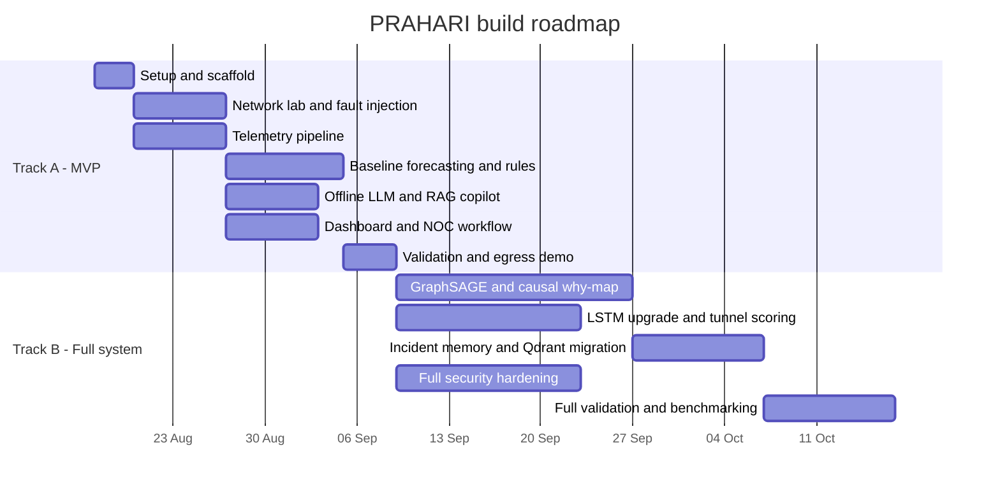

# PRAHARI — Research Findings & Build Plan

*Companion to `README.md` (vision/spec) and `prahari-packet-loss-design.md` (5-block architecture, feature engineering, classification logic). Those two answer **what** to build and **how each block works**. This document answers three things they don't: which of those technical choices actually hold up against current (Aug 2026) research and tooling, how to sequence the build so something real exists in week one, and what will most likely break.*

## 0. Orientation

One timing fact worth stating plainly: **Bharatiya Antariksh Hackathon 2026's grand finale already happened, August 6–7, 2026** — a week before today. If PRAHARI was aimed at that specific track, the hackathon clock has run out; this is no longer a "finish by the deadline" problem, it's a "build the real thing" problem. That's good news — it means the plan below doesn't need to be a 48-hour scramble. It's still built as two tracks, because starting with a small working slice and expanding it is just correct engineering practice regardless of deadlines.

## 1. Two build tracks

**Track A (MVP)** — the smallest version that is *actually predictive*, not a mockup: one lab topology, one fault type done well (packet loss — you already have the design for this), simple statistical forecasting instead of deep learning, a real local LLM producing a real schema-constrained brief, a thin dashboard. Everything in Track A is a genuine subset of Track B — nothing here gets thrown away.

**Track B (Full system)** — everything in the README: multi-fault classification, GNN-based topology anomaly detection, causal why-maps, incident memory reuse, full zero-egress attestation, all five validation scenarios benchmarked.

Rough timeline (solo, part-time around your placement prep, vs. a 3–4 person team run in parallel — you had a team for BAH, so use it if it's still around):

| | Solo, part-time | Team of 3–4, parallelized |
|---|---|---|
| Track A | ~5–6 weeks | ~2–2.5 weeks |
| Track B (additional) | ~3–4 months | ~6–10 weeks |

## 2. Research-grounded technology decisions

Each of these is: what the README/design doc proposed → what current research and tooling actually show → what to do about it.

### Forecasting engine
The design doc proposes LSTM, GRU, or Prophet per metric. Recent literature (2025–26) confirms LSTM/GRU still reliably beat ARIMA for network-style traffic forecasting, and a growing 2025 research thread on **time-series foundation models** is specifically targeting ISP/network traffic — zero-shot forecasting without training a model per metric, which is worth watching but not yet a safe bet to build on. Prophet is designed around daily/weekly business seasonality, which most fault precursors don't have — it's a weaker fit here than the design doc implies. The practical problem you'll hit before any of this matters is data volume: LSTM/GRU are hungry for labeled examples you don't have yet.
**Decision:** Track A ships with an EWMA/z-score trend detector plus a gradient-boosted tree (LightGBM) on windowed features — interpretable, works with a handful of fault-injection runs, fast to build. Add per-metric LSTM only once you've accumulated enough labeled fault-injection runs to justify it (Track B). Keep Prophet only for metrics that show real daily/weekly patterns (e.g. branch utilization, if your topology models office hours).

### Topology-aware anomaly detection
The design doc suggests GNNs or heuristic graph algorithms. Current SDN/network anomaly research leans on **GraphSAGE** specifically — it's cheaper to run than GCN/GAT for comparable accuracy, and papers report F1 scores around 0.7 on production-style anomaly workloads. But the same literature is consistent about GNNs' two weak spots, and both hit PRAHARI directly: limited interpretability (you need a root-cause hypothesis, not a black-box score) and a real appetite for diverse training data.
**Decision:** Track A uses a heuristic graph walk instead — from a triggered anomaly, traverse the topology graph and flag neighboring links/tunnels with correlated deviation, weighted by hop distance. Fully explainable, ships in days. Add GraphSAGE in Track B once fault-injection diversity is high enough, and always pair its score with the causal why-map below so a GNN output never stands alone as an unexplained number.

### Causal why-map (VAR-LiNGAM)
This one holds up well — `lingam` (the reference Python package, MIT-licensed) implements VAR-LiNGAM directly with a clean `.fit()` → `causal_order_` / `adjacency_matrices_` API, and is still being actively extended in 2026. The real constraint is the non-Gaussian-residual assumption, and that it's meant for a handful of carefully chosen variables, not every raw counter you're collecting.
**Decision:** worth building — it's genuinely what separates PRAHARI's "why" from a threshold alert. Scope it to run only on the 5–8 metrics inside a *triggered* anomaly window (utilization, loss, jitter, queue depth, error rate for the affected scope), not the full telemetry surface.

### Offline LLM copilot
README/design doc say "Llama, Qwen, or Phi" generically. As of August 2026, concretely: **Qwen3.6** has native tool-calling support in Ollama and comes in sizes from 8B up to a 27B dense model that reportedly beats Alibaba's own larger MoE on agentic tasks; **Gemma 4** (shipped April 2026, Apache 2.0) has an E-series built specifically for 8GB-class hardware with native function calling and structured JSON; **Phi-4-mini** is a good ultra-light fallback (~2.2GB). The one caution worth taking seriously: a 2026 tool-calling evaluation found that leaderboard rank doesn't predict reliable structured JSON at your actual quantization and chat template — some models marketed specifically for tool-calling scored far below general-purpose models once template mismatches were accounted for.
**Decision:** prototype with Qwen3.6 (size fit to whatever machine runs the demo) via Ollama — most mature current tool-calling support. Before trusting it for the incident-brief schema, run 20–30 test windows through it and check every response actually parses as valid JSON against your schema — don't assume the benchmark rank transfers. Keep Gemma 4 E2B/E4B as the fallback for genuinely constrained ops hardware.

### Embeddings and vector store
BGE (the design doc's pick) holds up — **BGE-M3** is described as the 2026 "production workhorse" for self-hosted RAG: MIT-licensed, runs on CPU, and does dense + sparse + multi-vector retrieval in one model, which is useful for runbooks that mix prose and exact device/interface names. If hardware is tighter, **Qwen3-Embedding-0.6B** (Ollama-native, ~1.5GB) or **nomic-embed-text** (~270MB) are the lighter fallbacks.
For the vector store itself, research on air-gapped RAG deployments is fairly consistent: **FAISS** is called the "gold standard" for exactly this case, specifically because it's an in-process library with zero external service — smaller attack surface, and there's no server process to have to prove isn't phoning home. **Qdrant** offers much stronger structured metadata filtering (by site, device, incident category), which the design doc's "affected scope" and IP-to-location lookup genuinely need — but it runs as its own local service.
**Decision:** Track A: FAISS + a plain in-memory metadata dict — fewer moving parts, easiest to demo zero-egress. Track B: migrate to Qdrant once filtered retrieval (by site/device/incident type) actually matters — still fully local, just one more process in the egress attestation.

### Network simulation lab
Containerlab + FRRouting checks out as the standard, actively-used approach for exactly this — working open reference labs exist for BGP, OSPF, MPLS with manual labels, LDP-distributed labels, and VRF+BGP L3VPN. Reported footprint is light (~350MB for a small topology, one comparison cites "75% less memory than GNS3/EVE-NG"), and topology is plain version-controlled YAML.
One concrete gotcha: **MPLS specifically does not run inside GitHub Codespaces or similar cloud devcontainers** — the containers can't load the kernel MPLS drivers they expect. BGP/OSPF-only labs are fine in a devcontainer; the MPLS core needs a real Linux host or VM.
**Decision:** don't author topology YAML from scratch — fork `martimy/clab_mpls_frr` (three progressive MPLS labs: manual labels → LDP → VRF+BGP L3VPN) or `ciscoittech/containerlab-free-labs` as your starting point and adapt it to PRAHARI's hub/branch/data-centre shape. Budget a real Linux box (bare metal or VM) once you're past the BGP/OSPF stage.

### Zero-egress attestation
README says "an eBPF sendmsg/sendto monitor." The concrete tool for this is **Tetragon** (CNCF/Cilium) — it has an out-of-the-box policy category literally called "monitor egress to external IPs," runs via eBPF with no kernel modifications, and — unlike a passive logger — can enforce in real time (kill or block a process that violates policy), not just alert after the fact. It runs standalone or in Kubernetes.
**Decision:** name Tetragon specifically as the mechanism, not a from-scratch eBPF program. That gets you a real, demoable artifact — a Tetragon egress policy plus its event log — and the enforcement mode gives you an honest "we block the leak, not just detect it" claim instead of a diagram-only promise.

### Config validation
README/design doc: pyang + ncclient, dry-run. This maps directly onto real NETCONF semantics (RFC 6241): edit the **candidate** datastore with `test-option=test-only` for a schema/dry-run check, then commit with the **confirmed-commit** capability — apply with a timeout, auto-rollback if nothing explicitly confirms it. This is the standard safe pattern network vendors themselves use.
**Decision:** implement it literally as that pipeline — pyang validates the proposed config against your YANG schemas offline, ncclient pushes to the candidate datastore with `test-only`, and if clean, commits with `confirmed=True` and a short timeout so any unintended change on your Containerlab devices reverts itself.

### Competitive landscape — be honest about this one
Air-gapped AI for critical infrastructure is a real, active pattern in 2026 with regulatory teeth behind it (CISA's 2026 AI-in-OT guidance, named state-sponsored groups targeting critical infrastructure) — the premise isn't contrived. But it's not empty space either: Dynatrace, IBM Cloud Pak for AIOps, Splunk, and LogicMonitor all already ship air-gapped/on-prem deployment modes. Worth saying this plainly in interviews rather than claiming false novelty. The honest differentiators at your scale: (1) purpose-built for the SD-WAN/MPLS network layer, not general IT observability; (2) a genuinely local LLM doing the reasoning, where most on-prem AIOps tools still lean on a vendor-hosted model even when telemetry stays on-prem; (3) zero licensing cost against contracts that start around $12K/year. One idea worth stealing directly: a 2026 paper on LLM-based AIOps in air-gapped systems reduces log volume by roughly three-quarters through a summarization stage before anything reaches the LLM's context — worth adding as an explicit step before your RAG context assembly, both for your local model's context budget and because it's a legitimately citable technique.

## 3. Refined architecture

```mermaid
flowchart TB
    subgraph AG[Air-gapped boundary]
        N[Containerlab network] --> ING[Telemetry ingestion]
        ING --> FEAT[Feature extraction and labeling]
        FEAT --> PRED[Predictive analytics engine]
        PRED --> CLASS[Incident classification]
        CLASS --> SUM[Evidence summarizer]
        SUM --> RAG[Offline RAG and LLM copilot]
        KB[(Knowledge base)] --> RAG
        MEM[(Incident memory)] --> RAG
        CLASS --> MEM
        RAG --> DASH[NOC dashboard]
        DASH --> VALID[pyang check, ncclient test-only, confirmed-commit]
        VALID --> N
        EGRESS[Tetragon egress policy] -.watches.-> AG
    end
    CLOUD[Internet and cloud APIs] -. deny-all egress .-> AG
```

Two additions versus the README's diagram: an explicit **evidence summarizer** between classification and the LLM (the log-reduction idea above — compress the evidence window before it hits the copilot's context, not after), and **Tetragon named explicitly** as the egress-attestation mechanism rather than a generic eBPF box.

## 4. Repository structure

```
prahari/
├── network-lab/           # Containerlab topology YAML, FRR configs
│   ├── topologies/
│   └── fault-injection/   # tc netem / TRex scripts, auto-labeled output
├── telemetry/              # collectors, Prometheus config, common schema
├── analytics/
│   ├── forecasting/        # EWMA/z-score baseline -> LightGBM -> LSTM (Track B)
│   ├── anomaly/             # heuristic graph walk -> GraphSAGE (Track B)
│   ├── tunnel_scoring/
│   ├── causal/               # VAR-LiNGAM, scoped to triggered windows
│   └── ensemble/
├── classification/           # rule engine + ML classifier (Track B)
├── copilot/
│   ├── ingestion/             # runbooks, configs -> chunks
│   ├── summarizer/             # evidence-window compression before LLM context
│   ├── retrieval/               # FAISS (Track A) -> Qdrant (Track B)
│   ├── prompts/
│   └── schemas/                  # incident-brief JSON schema
├── incident_memory/                # Track B
├── config_validation/               # pyang schemas, ncclient test-only + confirmed-commit
├── security/                         # nftables rules, Tetragon policies, attestation report
├── backend/                           # FastAPI
├── dashboard/                          # React
├── docs/
└── eval/                                # validation-scenario harness, precision/recall/lead-time
```

## 5. Phased roadmap



- **Phase 0 — Setup.** Repo scaffold above, Containerlab installed, fork the MPLS/BGP lab you're adapting.
- **Phase 1 — Network + fault injection.** Get the forked lab pinging end to end, then layer `tc netem`/TRex fault scripts that auto-label every injected condition (timestamp, type, affected interface) — start accumulating labeled data from day one, not at the end.
- **Phase 2 — Telemetry pipeline.** One real metric flowing (interface utilization is easiest) into Prometheus before worrying about the rest of the sources in the design doc's Block 1 table.
- **Phase 3 — Baseline forecasting + rule-based classification.** EWMA/z-score + LightGBM, plus the rule-based incident-type checks from the design doc's Block 4 — this is where Track A's "predictive" claim actually gets earned.
- **Phase 4 — Offline LLM + RAG copilot.** One hard-coded telemetry window turned into a schema-valid JSON incident brief, before optimizing any earlier block. This is the highest-value early milestone: it proves the whole shape of the system works.
- **Phase 5 — Dashboard + NOC workflow.** Topology view, incident cards, evidence, copilot chat — can run in parallel with Phase 3/4 if you have a teammate on it.
- **Phase 6 — Validation + zero-egress demo.** Run the design doc's five scenarios, wire up the Tetragon policy and nftables rules, capture the egress event log as evidence.
- **Phase 7+ (Track B).** GraphSAGE, VAR-LiNGAM scoped to triggered windows, LSTM upgrade once labeled volume justifies it, Qdrant migration, incident-memory matching at the README's 85% threshold, full security hardening, full benchmark writeup.

## 6. The data problem — the biggest real risk

Every model in the predictive block needs labeled examples of what telemetry looks like in the minutes *before* a fault. There's no historical production data to draw on here — that's the whole premise of a simulated, air-gapped lab — so every label comes from your own fault-injection harness. Three specific risks follow from that:

- **Sim-to-real gap.** Synthetic `tc netem`/TRex faults may not resemble how real degradation actually looks. Mitigate by randomizing timing, magnitude, site, and fault combinations rather than running the same clean scenario repeatedly.
- **Class imbalance.** Normal operation vastly outweighs fault windows in any dataset you generate. Statistical baselines and rule thresholds tolerate this far better than deep models do.
- **Volume.** LSTM and GraphSAGE need many diverse runs to generalize. A handful of manual demo runs is enough to sanity-check a deep model, not to train one meaningfully.

The practical fix threaded through the whole plan above: automate fault injection as a labeled batch job so you can generate hundreds of windows overnight, treat every deep-learning component as something you *earn the right to add* once labeled volume justifies it, and let your five validation scenarios double as your actual test set — track precision, recall, and lead time per scenario, not "it worked on my demo run."

## 7. Risk register

| Risk | Likelihood | Impact | Mitigation |
|---|---|---|---|
| Not enough labeled fault data for deep models | High | High | Automate batch fault injection; ship statistical baselines first |
| Local LLM emits invalid JSON at your actual quantization | Medium | Medium | Validate the exact build against 20–30 schema test cases before relying on it; add a schema-repair retry loop |
| MPLS won't run in a cloud devcontainer | Medium | Medium | Provision a real Linux host/VM before the MPLS phase |
| GraphSAGE/VAR-LiNGAM become a time sink for little demo payoff | Medium | Medium | Track B only — ship Track A with the heuristic/statistical equivalents first |
| Teammates block on the network lab existing before telemetry work can start | Medium | Medium | Minimal 3-node lab in Phase 0 so telemetry/ML work can start against real (if small) data immediately |
| "Zero-egress" is a diagram claim, not a demoable fact | Medium | High (credibility) | Tetragon policy + captured event log as literal evidence, not just architecture text |

## 8. Validation scenarios — starting targets

Same five scenarios as the README; treat these numbers as hypotheses to test and refine, not requirements handed down from research:

| Scenario | Target lead time | Target precision | Target recall |
|---|---|---|---|
| Hub-spoke congestion | ≥2 min before saturation | ≥0.7 | ≥0.7 |
| Route flap cascade | ≥1 min before cascade | ≥0.6 | ≥0.7 |
| Tunnel/underlay degradation | ≥2 min before SLA breach | ≥0.7 | ≥0.6 |
| Policy drift | Detected within 1 config-check cycle | ≥0.8 | ≥0.7 |
| Repeated known incident | Immediate (memory hit) | ≥0.9 | ≥0.85 (per README's stated threshold) |

## 9. Immediate next steps (this week)

1. Create the repo with the structure in §4; commit the README, the design doc, and this plan as-is.
2. Fork `martimy/clab_mpls_frr` or `ciscoittech/containerlab-free-labs`; get a 3–4 node BGP+MPLS topology pinging on a real Linux host or VM (not a cloud devcontainer).
3. Stand up Prometheus plus a small Python poller against the lab; get one real metric — interface utilization is easiest — flowing into a time-series store.
4. `ollama pull` a Qwen3.6 build sized to your hardware; feed it one hard-coded telemetry window and get back a schema-valid JSON incident brief. This proves the end-to-end shape before any single block gets optimized.
5. Write the first `tc netem` fault-injection script with automatic labeling, so labeled data starts accumulating from day one instead of at the end.

## 10. Sources

- ISRO BAH 2026 grand finale dates — https://www.isro.gov.in/Bharatiya_Antariksh_Hackathon_2026_Grand_Finale.html
- Time-series foundation models for ISP traffic forecasting (2025) — https://www.arxiv.org/pdf/2511.17529
- Local LLM landscape, Aug 2026 — https://localaimaster.com/blog/small-language-models-guide-2026 · https://insiderllm.com/guides/function-calling-local-llms/ · https://www.jdhodges.com/blog/local-llms-on-tool-calling-2026-pt1-local-lm/
- Vector database choice for air-gapped RAG — https://www.starteck.co.uk/blog/vector-databases-choosing-the-right-one · https://presenc.ai/research/on-device-rag-performance-benchmarks-2026
- Containerlab + FRRouting reference labs — https://github.com/martimy/clab_mpls_frr · https://github.com/martimy/clab-bgp-frr · https://github.com/ciscoittech/containerlab-free-labs · https://blog.ipspace.net/2026/05/sr-mpls-intro/
- eBPF egress monitoring / Tetragon — https://kubezilla.io/cilium-tetragon-ebpf-powered-runtime-security-for-kubernetes-and-docker/ · https://www.decryptiondigest.com/blog/ebpf-runtime-security-tools-falco-tetragon
- GNN-based SDN anomaly detection — https://www.sciencedirect.com/science/article/pii/S2772918424000456 · https://onlinelibrary.wiley.com/doi/10.1002/spy2.337
- VAR-LiNGAM reference implementation — https://github.com/cdt15/lingam
- Embedding model landscape, 2026 — https://d-central.tech/local-embedding-models/ · https://innovativeais.com/blog/best-embedding-models-for-rag-in-2026
- Air-gapped AI for critical infrastructure / on-prem AIOps — https://oxmaint.com/sap-integration/air-gapped-ai-critical-infrastructure · https://metoro.io/blog/on-prem-aiops-tools · https://dl.acm.org/doi/10.1145/3805621.3807626
- NETCONF candidate/test-only/confirmed-commit semantics (RFC 6241) — https://datatracker.ietf.org/doc/html/rfc6241
